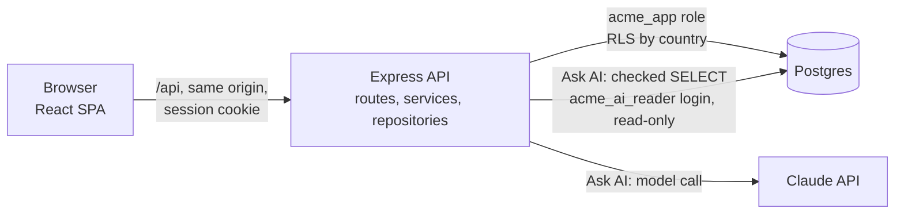

# ACME Salary Management

A web app for ACME's HR team to look after the pay of 10,000 employees across 8 countries, replacing their Excel files. An HR manager can find anyone in seconds, add joiners and record leavers, change pay with a permanent history (date, reason, previous amount), import the spreadsheets they already have, and answer "how do we pay people?" from an Insights screen or by asking a question in plain English (Ask AI). Country HR staff only ever see their own countries, and the database enforces that.

- **Live app:** https://acme-salary-management-9fjv.onrender.com (public help guide at [/help](https://acme-salary-management-9fjv.onrender.com/help))
- **Video demo:** _link to be added_
- **Demo sign-in:** see [Demo accounts](#demo-accounts)

## How this maps to the brief

| Brief asks for | Where it is |
| --- | --- |
| One-page requirements doc, written before building | [docs/requirements.md](docs/requirements.md) (goal, scope, what's left out and why). Committed (`671f142`) right after the empty scaffold, before any feature code. |
| End-to-end software, backend and UI | Express 5 API in [apps/api](apps/api), React app in [apps/web](apps/web), shared contracts in [packages/shared](packages/shared) |
| Relational database | Postgres with Drizzle ORM and row-level security: [docs/database.md](docs/database.md), migrations in [apps/api/drizzle](apps/api/drizzle) |
| React UI with a component library | React 19 on Vite with Mantine 9 ([ADR 0004](docs/adr/0004-mantine-css-modules.md)). Vite was chosen over Next.js because the Express API already owns the server side ([decision #6](docs/decisions.md)). |
| Seed script with 10,000 employees | `npm run db:seed` ([apps/api/src/db/seed](apps/api/src/db/seed)): deterministic, 10,000 employees in 8 countries |
| Fully functional deployed software | https://acme-salary-management-9fjv.onrender.com (one Render web service plus Render Postgres, [decision #8](docs/decisions.md)) |
| Video demo | Not linked yet |
| Fast, deterministic unit tests of core functionality | 544 tests in 104 files, about 18 s with `npm test`. See [Testing](#testing). |
| Agentic AI tools | Claude Code, with [CLAUDE.md](CLAUDE.md) as the standing instructions. See [How AI tools were used](#how-ai-tools-were-used). |
| Incremental commits | `git log`: about 100 commits, from scaffold to requirements, component library, contracts, database, API, screens, Ask AI, then refactors and fixes, mostly through pull requests |
| Planning and design notes, architecture, trade-offs, performance | [docs/](docs/) (see [Docs index](#docs-index)), the [decision log](docs/decisions.md) and the [ADRs](docs/adr/) |

## Features

What the HR manager can do (details and success measures in [docs/requirements.md](docs/requirements.md)):

| Feature | What it does |
| --- | --- |
| Employee directory | Server-side search by name, email or code, filters (country, department, title, status), sort and pagination over 10,000 people |
| Add, edit, terminate | Create and update people. Leavers are terminated, never deleted, and become read-only. |
| Salary changes with history | New amount, effective date and reason. History is permanent and every change is in the audit log. |
| Insights | Per country and job title: headcount, min, median, average, max and spread, plus payroll per country |
| Ask AI | Plain-English questions about pay. Shows its steps in plain English. It can only *draft* a salary change, which a person reviews and applies. |
| Excel and CSV import | Upload the sheet HR already uses. Columns are matched from its headers, every row is previewed as new, updated or an error, then applied in one step (with undo). |
| CSV export | Exports the current filtered list |
| Sign-in and roles | Global HR (all countries) and Country HR (assigned countries) are seeded. Global HR can invite people and create roles from a fixed set of permissions. |
| Help guide | A public `/help` page that walks through each screen |

### Deliberately left out

From [docs/requirements.md](docs/requirements.md#deliberately-out-of-scope):

| Left out | Why |
| --- | --- |
| Screens for managers, finance and employees | HR doesn't need them today. Global HR can still create such roles from the existing permissions. |
| AI that edits data directly | Pay changes need a human decision and an audit trail, so the assistant only reads and drafts. |
| Payroll, tax, payslips | A different product with country-specific legal rules |
| Bonus, equity, benefits | Base pay answers the stated questions, and total compensation multiplies the data model. |
| Live two-way sync with Excel or HR systems | Import covers the switch-over. Ongoing sync needs rules for which system wins a conflict. |
| Approval workflows, notifications | Needs more than one user first |

Also not in v1: invite emails (Global HR copies the link by hand), SSO and MFA ([docs/auth.md](docs/auth.md#deliberately-not-doing)).

## Architecture

TypeScript throughout, in an npm workspaces monorepo:

```
apps/web          React 19 + Vite SPA, Mantine 9 and CSS modules, Recharts, react-router
apps/api          Express 5 API, Drizzle ORM, Postgres; also serves the built web app
packages/shared   Zod schemas for every request and response, used by both apps
docs/             requirements, design docs, decision log, ADRs
```



- **One deploy, one origin.** The API serves the built UI, so cookies need no CORS ([decision #8](docs/decisions.md)).
- **REST with shared Zod contracts.** Salary changes and terminations are their own commands, not a `PATCH`, so pay can't change without a reason and history ([ADR 0001](docs/adr/0001-api-style.md), [docs/api.md](docs/api.md)).
- **Access enforced in the database.** Sessions live in Postgres. Each request runs as the `acme_app` role in a transaction that sets the user's countries, and row-level security filters every query. A Country HR user can't see other countries even if a query has a bug ([ADR 0002](docs/adr/0002-auth-approach.md), [docs/auth.md](docs/auth.md)).
- **Roles in the database.** A role is a set of permissions plus a country scope, and every route names the permission it needs ([decision #23](docs/decisions.md)).
- **Layered API with constructor injection.** Routes call services, and services call repositories. Everything is wired in one composition root, `apps/api/src/services.ts`, so tests can pass a fixed clock or a scripted model ([decision #31](docs/decisions.md)).
- **Ask AI safety.** The model writes SQL, but a real Postgres parser lets through only one `SELECT` on allowed tables. It runs as a separate read-only login with a timeout and row cap, and column grants keep names and emails from the model ([decisions #36–#44](docs/decisions.md), [docs/api.md](docs/api.md#ask-ai)).
- **Money.** Stored as integer minor units in the country's currency. Amounts in different currencies are never summed or compared; org-wide totals are labelled as indicative USD.
- **UI.** Atomic-design component folders with a lint rule on import direction, previewed in Ladle ([docs/ui.md](docs/ui.md)). Visual direction inspired by the Dribbble shot [Agentic Dashboard](https://dribbble.com/shots/27449642-Agentic-Dashboard).

## Performance at 10,000 employees

The target in the requirements is API responses under 200 ms at 10,000 employees.

- **Server-side pagination, filtering and sorting.** The page size defaults to 25 (max 100), and `id` is the tiebreaker, so pages are stable. The total is a separate count query: a window `count(*) over ()` made every page sort all rows in scope (11 ms vs 0.5 ms for the first page, [decision #35](docs/decisions.md)).
- **Indexes chosen for the queries and for RLS.** A partial index on active employees by `(country, title, salary)` serves insights, the country filter and the RLS predicate. Salary history is indexed by employee and date. `salary_changes` keeps its own copy of the country so its policy stays an index condition. See [docs/database.md](docs/database.md#indexes), including how RLS limits which indexes Postgres can use.
- **No trigram index for search.** `ILIKE` isn't leakproof, so Postgres can't use such an index under RLS. Search measured about 3.5 ms without one.
- **Aggregates in SQL.** Medians (`percentile_disc`), histograms (`width_bucket`) and payroll totals are computed in Postgres, not in Node.
- **Batched writes.** The seed and imports insert in batches, and the seed runs `ANALYZE` afterwards so the planner has statistics.
- **Client.** Search is debounced (300 ms), each screen is a lazy-loaded route, and the shared catalogue is served with an ETag.
- **Ask AI memory.** The API runs with `node --liftoff-only`. Without it, the WebAssembly SQL parser's first check took about 600 MB, which got the 512 MB Render instance killed.

## Testing

```bash
npm test          # every workspace, about 18 s, no setup needed
npm run test:watch
npm run test:e2e  # browser smoke test; run `npx playwright install chromium` once first
```

- **What's covered:** pure business rules (salary changes, hire and termination dates, import planning), shared Zod contracts, the deterministic seed generator, every API endpoint over HTTP with row-level security on (including Country HR never seeing other countries), the Ask AI SQL guard, Ask AI with a scripted model, and each UI component and screen view with React Testing Library.
- **Fast and deterministic:** the rules are pure functions. Services get a fixed clock through their constructors, the seed comes from a fixed random seed, and Ask AI tests use a scripted model instead of the real API. Database tests run against real Postgres, because the point is to prove the database enforces scope. `npm test` starts a throwaway embedded Postgres itself (`apps/api/src/test/global-setup.ts`), or uses `TEST_DATABASE_URL` if set.
- **Browser smoke test:** a Playwright test ([e2e/](e2e)) builds the web app, starts it on a throwaway seeded Postgres ([apps/api/src/test/e2e-server.ts](apps/api/src/test/e2e-server.ts)) and signs in as Global HR to find someone, record a raise and see it in their salary history.
- **Ask AI evals:** 27 cases, including prompt injection and requests for names, with expected answers computed from the seed. The scripted-model suite runs in `npm test`. `npm run evals` runs them against the real model and costs tokens.
- **CI** ([.github/workflows/ci.yml](.github/workflows/ci.yml)) runs format check, lint, typecheck, tests against a Postgres service container, build, and the Playwright smoke test on every push and pull request.

## How AI tools were used

- **Tool:** Claude Code was the agentic tool for planning, design docs, code and tests.
- **Standing instructions:** [CLAUDE.md](CLAUDE.md). The AI never commits or pushes, and it looks up Mantine's current API through the Mantine docs MCP server ([.mcp.json](.mcp.json), [decision #21](docs/decisions.md)) instead of relying on memory.
- **Review:** the developer reviewed every change and made each commit by hand ([decision #17](docs/decisions.md)).
- **Process choices on record:** the API, auth and UI designs were drafted by three parallel subagents and then reconciled ([decision #15](docs/decisions.md)), and a third-party skill was read for reference rather than installed ([decision #16](docs/decisions.md)).
- **In the product:** Ask AI uses the Claude API, with the guard rails described above.

## Run locally

**Prerequisites:** Node 24 (`.nvmrc`, at least 22) and Postgres 16 or later.

1. **Install:** `npm install`
2. **Configure:** copy [.env.example](.env.example) to `.env` at the repo root and fill it in. Never commit `.env`.
   - `DATABASE_URL_MIGRATOR`: the database owner's connection string (migrations and seed)
   - `DATABASE_URL`: the API's connection. Locally it can be the same as the migrator, because the API switches to the `acme_app` role.
   - Ask AI is optional. Without `ANTHROPIC_API_KEY` and `DATABASE_URL_AI` it returns `503 ai_unavailable` and everything else works. Setup is in [Ask AI setup](#ask-ai-setup-optional).
3. **Migrate and seed:**

   ```bash
   npm run db:migrate
   SEED_DEMO_USERS=true DEMO_PASSWORD='<choose one>' npm run db:seed
   ```

   The seed creates 10,000 synthetic employees with about 24,000 salary history entries, the same on every run. It refuses to run on a database that already has employees; add `-- --reset` to replace them. Other options: `--employees 500`, `--seed 42`, `--as-of 2026-11-01`.
4. **Run:** `npm run dev` starts the API on port 3000 and the web app on http://localhost:5173 (it proxies `/api`).
5. **Check:** `npm test`, `npm run lint`, `npm run typecheck`, `npm run build`. Component workshop: `npm run ladle -w @acme/web`.

To change the schema, edit `apps/api/src/db/schema`, run `npm run db:generate`, review the SQL in `apps/api/drizzle`, then `npm run db:migrate` ([docs/database.md](docs/database.md)).

### Ask AI setup (optional)

1. `npm run db:migrate` creates the read-only `acme_ai_reader` role with no login.
2. Enable its login as the migrator, with a password of at least 16 characters: `DATABASE_URL_MIGRATOR=… ACME_AI_READER_PASSWORD=… npm run db:roles`. Run it again to rotate the password.
3. Set `DATABASE_URL_AI` (the same database, as `acme_ai_reader`) and `ANTHROPIC_API_KEY`. Models and budgets are the `AI_*` settings ([decisions #38 and #40](docs/decisions.md)).
4. Monitoring: `GET /api/ai/sql-runs` (every SQL attempt), `GET /api/ai/metrics`, and `GET /api/health`. Set `METRICS_TOKEN` to expose Prometheus text at `/metrics`.

## Demo accounts

When run with `SEED_DEMO_USERS=true`, the seed creates three sign-ins. They share the password in `DEMO_PASSWORD`, which is never stored in the repo:

| Email | Role | Sees |
| --- | --- | --- |
| `global.hr@demo.acme.test` | Global HR | All 8 countries; manages access and roles |
| `india.hr@demo.acme.test` | Country HR | India only |
| `uk-us.hr@demo.acme.test` | Country HR | United Kingdom and United States |

The password for the live app is shared with reviewers separately. All data is synthetic.

## Docs index

| Doc | What it covers |
| --- | --- |
| [docs/requirements.md](docs/requirements.md) | One-page requirements: problem, user, success measures, scope, what's left out |
| [docs/decisions.md](docs/decisions.md) | Decision log: every notable choice, the alternatives and why, plus open questions |
| [docs/adr/0001-api-style.md](docs/adr/0001-api-style.md) | ADR: REST over JSON, shared Zod contracts, commands for domain events |
| [docs/adr/0002-auth-approach.md](docs/adr/0002-auth-approach.md) | ADR: sessions in Postgres, RBAC and row-level security |
| [docs/adr/0003-ui-library.md](docs/adr/0003-ui-library.md) | ADR: Ant Design (superseded by 0004) |
| [docs/adr/0004-mantine-css-modules.md](docs/adr/0004-mantine-css-modules.md) | ADR: Mantine 9 with CSS modules as the only styling mechanism |
| [docs/api.md](docs/api.md) | HTTP API: conventions, endpoints, shapes, import flow, Ask AI |
| [docs/auth.md](docs/auth.md) | Authentication, roles and permissions, database roles, RLS policies, auth test plan |
| [docs/database.md](docs/database.md) | Tables, constraints, indexes, and how they interact with RLS |
| [docs/ui.md](docs/ui.md) | Component library, screens and routes, responsive layout, theming, accessibility |
| [CLAUDE.md](CLAUDE.md) | Standing instructions for the AI coding tool |

The visual designs and plans were made as claude.ai artifacts, which open only for people the owner has shared them with. The written versions are the docs above: [UI Design](https://claude.ai/artifact/QzyAt4YWZdkEfquH1jWT7y), [Requirements](https://claude.ai/artifact/KZHfskEayTD5jTwuRAgi9r), [Auth Design](https://claude.ai/artifact/7TkVuqNHNnfTVfRpsomgtc), [Database Design](https://claude.ai/artifact/B2kPMpoBH9EuFDpKQgwHtW), [Salary Database schema](https://claude.ai/artifact/1J9AyCP5DMfDHLQHXXqwEQ), [API and Database Plan](https://claude.ai/artifact/U4tbeYzu3z89NWFk3hinPP), [API and Database Build Plan](https://claude.ai/artifact/AXEkC7C1qnEwNnhGJu2mhC), [Import Queue and Caching Plan](https://claude.ai/artifact/GqseU3MHP9S2aHUrpaWkSw), [Ask AI Text-to-SQL Plan](https://claude.ai/artifact/PKQHWJPFmfT49HYUWBykXA).
