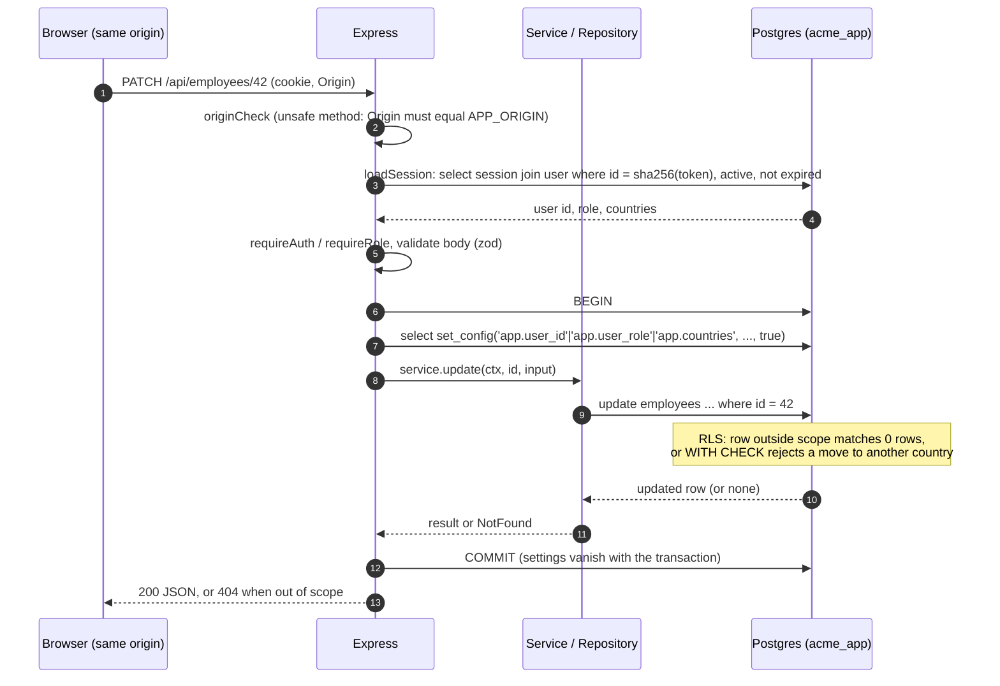

# Authentication and authorization

How ACME Salary Management knows who is calling and limits what they can see. Decision record: [ADR 0002](adr/0002-auth-approach.md). Endpoint shapes and error format follow [api.md](api.md); this document only fixes the auth-related parts.

## Goals

- Only invited HR staff can sign in. Global HR manages who has access.
- Country HR sees and changes only their assigned countries, in every feature (lists, insights, exports, import, Ask AI). This is enforced **in Postgres with row-level security (RLS)**, so a missed `where` clause in application code cannot leak data.
- Every write has an actor, for the audit log.
- Small enough to read in one sitting: standard pieces, no auth framework.

## Threat model (short)

| Threat | Mitigation |
| --- | --- |
| Country HR reads other countries (bug, crafted request, ID guessing) | RLS on every scoped table; out-of-scope rows return 404, not 403 |
| Ask AI is prompt-injected into reading other countries | Scope comes from the session; AI SQL runs as a read-only DB role whose scope it cannot change (see [Ask AI](#ask-ai-the-one-place-where-a-guc-is-not-enough)) |
| Stolen database backup or log contains session tokens | Only SHA-256 hashes of tokens are stored |
| Password guessing / credential stuffing | argon2id, per-IP rate limit, per-account temporary lock, same error for every failure |
| CSRF from another site | `SameSite=Lax` cookie plus an `Origin` check on every state-changing request |
| XSS steals session | `HttpOnly` cookie; strict CSP from the API |
| Former employee keeps access | Deactivation deletes all their sessions immediately; role and countries are re-read on every request |
| App bug runs DDL or bypasses RLS | App connects as a non-owner role without `BYPASSRLS`; only the migrator owns tables |

Out of scope: a compromised Render account or DB superuser, and malware on an HR laptop.

## Chosen approach

- **Server-side sessions in Postgres**, referenced by an opaque random token in an `HttpOnly` cookie. Not JWT: we need instant revocation (deactivate, password change), the web app is same-origin, and there is one server, so stateless tokens add risk and buy nothing.
- **Hand-rolled, about 200 lines**, following the Lucia session guide ([lucia-auth.com](https://lucia-auth.com/)) and the OWASP Session Management cheat sheet ([link](https://cheatsheetseries.owasp.org/cheatsheets/Session_Management_Cheat_Sheet.html)). No Better Auth, Passport or Clerk; reasons in the ADR.
- **Email and password with argon2id** (`@node-rs/argon2`, prebuilt binaries, no node-gyp), OWASP parameters: memory 19 MiB, 2 iterations, parallelism 1 ([OWASP Password Storage](https://cheatsheetseries.owasp.org/cheatsheets/Password_Storage_Cheat_Sheet.html)). Passwords: 12 to 128 characters, no composition rules ([NIST SP 800-63B](https://pages.nist.gov/800-63-4/sp800-63b.html)).
- **Invite links** created by Global HR. The same mechanism resets a forgotten password (Global HR re-issues a link). No email sending in v1: the link is shown once to the Global HR user to pass on.

## Data model

All IDs are `uuid` (`gen_random_uuid()`), all times `timestamptz`.

**`users`**

| Column | Type | Notes |
| --- | --- | --- |
| `id` | uuid PK | |
| `email` | `citext` unique | Case-insensitive sign-in |
| `name` | text | |
| `role` | enum `user_role`: `global_hr`, `country_hr` | |
| `status` | enum `user_status`: `invited`, `active`, `deactivated` | Only `active` can sign in |
| `password_hash` | text null | argon2id PHC string; null until the invite is accepted |
| `failed_sign_ins` | int default 0 | Reset on success |
| `locked_until` | timestamptz null | Temporary lock after repeated failures |
| `created_by` | uuid null FK users | Null for the bootstrap admin |
| `created_at`, `updated_at`, `deactivated_at` | timestamptz | |

**`user_countries`**: `user_id` FK users (on delete cascade), `country_code` char(2) FK `countries`, PK (`user_id`, `country_code`). Rows only for `country_hr`; the service requires at least one. Global HR needs none (the role means "all").

**`sessions`**

| Column | Type | Notes |
| --- | --- | --- |
| `id` | bytea PK | SHA-256 of the cookie token. The token itself is never stored |
| `user_id` | uuid FK users, on delete cascade | Indexed |
| `created_at` | timestamptz | |
| `last_seen_at` | timestamptz | Idle timeout; written at most every 5 minutes |
| `expires_at` | timestamptz | Absolute timeout: `created_at + 12h` |
| `ip`, `user_agent` | text null | For "where am I signed in" and incident review |

**`invites`** (also used for password resets)

| Column | Type | Notes |
| --- | --- | --- |
| `token_hash` | bytea PK | SHA-256 of the link token |
| `user_id` | uuid FK users, on delete cascade | The user row is created at invite time with `status = 'invited'` |
| `created_by` | uuid FK users | |
| `created_at` | timestamptz | |
| `expires_at` | timestamptz | `created_at + 72h` |
| `used_at` | timestamptz null | Single use |

Tokens (session and invite) are 32 bytes from `crypto.randomBytes`, base64url-encoded. Hashing with plain SHA-256 is enough because the tokens have 256 bits of entropy; a slow hash is only needed for low-entropy secrets like passwords.

Auth tables (`users`, `user_countries`, `sessions`, `invites`) are **not** under RLS: the session lookup has to happen before we know the scope, and they hold no salary data. Access to the user-admin endpoints is checked in code (`requireRole('global_hr')`), and the Ask AI role has no grant on them at all.

## Database roles

Three roles, so the code that serves requests can never bypass RLS or change the schema.

| Role | Login | Used by | Can |
| --- | --- | --- | --- |
| `acme_owner` | yes | Kysely migrations, seed script (`DATABASE_URL_MIGRATOR`) | Owns all tables and functions. Never used by the running server |
| `acme_app` | yes | The API server (`DATABASE_URL`) | `select/insert/update` on business tables, `insert` only on `salary_changes` and `audit_events`; no `delete`, `truncate` or DDL; `NOBYPASSRLS` |
| `acme_ai_reader` | yes | Ask AI `run_sql` tool only (`DATABASE_URL_AI`, pool of 2) | `select` on employees, salary_changes, countries, catalogues. Nothing else, including no `TEMP` |

```sql
-- Run once by the migrator. Passwords come from env via the roles script, never from a migration file.
create role acme_app login nobypassrls;
create role acme_ai_reader login nobypassrls;
revoke temp on database acme from public;
revoke create on schema public from public;

grant usage on schema public to acme_app, acme_ai_reader;
grant select, insert, update on employees, users to acme_app;
grant select, insert, update, delete on sessions, invites to acme_app;  -- sign-out, revocation
grant select, insert, delete on user_countries to acme_app;             -- reassigning countries
grant select, insert on salary_changes, audit_events to acme_app;  -- history is append-only
grant select on employees, salary_changes, countries, job_titles, departments to acme_ai_reader;
alter role acme_ai_reader set default_transaction_read_only = on;
alter role acme_ai_reader set statement_timeout = '5s';
```

Because neither runtime role owns the tables, RLS applies to them without `FORCE ROW LEVEL SECURITY`. We set `FORCE` anyway so that the seed script, which runs as owner, also exercises the policies.

## RLS policies

The request scope lives in three transaction-local settings, set by `withScopedTransaction` (below):

- `app.user_id` — actor for audit rows
- `app.user_role` — `global_hr` or `country_hr`
- `app.countries` — comma-separated country codes, for example `IN,GB`

Policies read the scope through small functions so the rules are written once. **Missing settings mean no access**, so a query that forgets the scoped transaction gets zero rows instead of everything.

```sql
create schema app_private;

create function app_private.scope_role() returns text
language sql stable as $$
  select case
    when session_user = 'acme_ai_reader' then
      (select role from app_private.ai_scope
        where backend_pid = pg_backend_pid() and expires_at > now())
    else nullif(current_setting('app.user_role', true), '')
  end
$$;

create function app_private.scope_countries() returns text[]
language sql stable as $$
  select case
    when session_user = 'acme_ai_reader' then
      (select countries from app_private.ai_scope
        where backend_pid = pg_backend_pid() and expires_at > now())
    else string_to_array(nullif(current_setting('app.countries', true), ''), ',')
  end
$$;

-- employees: the only table that carries country_code directly
alter table employees enable row level security;
alter table employees force row level security;

create policy employees_in_scope on employees
  for all to acme_app, acme_ai_reader
  using (
    (select app_private.scope_role()) = 'global_hr'
    or country_code = any ((select app_private.scope_countries()))
  )
  with check (  -- also blocks moving an employee into a country you don't cover
    (select app_private.scope_role()) = 'global_hr'
    or country_code = any ((select app_private.scope_countries()))
  );

-- salary_changes: visible when the employee is visible. The subquery is itself filtered by
-- the employees policy, so the country rule exists in one place.
alter table salary_changes enable row level security;
alter table salary_changes force row level security;

create policy salary_changes_in_scope on salary_changes
  for all to acme_app, acme_ai_reader
  using (exists (select 1 from employees e where e.id = employee_id))
  with check (exists (select 1 from employees e where e.id = employee_id));

-- audit_events (assumes it stores the affected employee's country_code): same rule for reads;
-- inserts must name the current actor.
alter table audit_events enable row level security;
alter table audit_events force row level security;

create policy audit_read on audit_events for select to acme_app
  using ((select app_private.scope_role()) = 'global_hr'
         or country_code = any ((select app_private.scope_countries())));
create policy audit_insert on audit_events for insert to acme_app
  with check (actor_id = nullif(current_setting('app.user_id', true), '')::uuid);
```

Notes:

- `(select fn())` makes Postgres evaluate the function once per query instead of once per row, which keeps insights over 10,000 rows fast. `employees(country_code)` is indexed.
- Import and other batch jobs use the same tables and the same policies; there is no privileged path.
- Recommended for the audit log: a trigger on `employees` and `salary_changes` that writes before/after rows using `app.user_id`. It fails if the setting is missing, so no write can happen without an actor. (Exact audit design lives with the data model.)

### Ask AI: the one place where a GUC is not enough

Custom settings like `app.countries` can be changed by **any** role with `set_config()`. That is fine for `acme_app`, whose SQL we write and parameterize. It is not fine for SQL written by a model, which could be prompt-injected into `select set_config('app.countries', 'US,GB', true)`.

So the AI role reads its scope from a table it cannot write, keyed by its own connection's backend PID, which Postgres assigns and SQL cannot change:

```sql
create table app_private.ai_scope (
  backend_pid int primary key,
  role user_role not null,
  countries text[] not null,
  expires_at timestamptz not null
);
grant select, insert, update, delete on app_private.ai_scope to acme_app;
grant select on app_private.ai_scope to acme_ai_reader;
grant usage on schema app_private to acme_app, acme_ai_reader;
grant execute on all functions in schema app_private to acme_app, acme_ai_reader;
```

Flow for one `run_sql` call:

1. Check out a connection from the AI pool and read its `pg_backend_pid()`.
2. On the app connection, upsert `ai_scope(pid, role, countries, now() + 30s)` from the **session**.
3. On the AI connection: `begin read only`, run the model's single statement (extended protocol, so no stacked statements), `rollback`.
4. Delete the `ai_scope` row; release the connection.

`acme_ai_reader` is a separate login role (not `SET ROLE` from `acme_app`), because `RESET ROLE` would let SQL climb back to the session user. This relies on direct connections; transaction-mode PgBouncer would break the PID mapping. Defense in depth in code: parse the SQL and allow only a single `SELECT` with a function allow-list, and cap rows returned.

## Request flow



## Endpoints

Paths follow `docs/api.md`; adjust there if names differ. All responses carry `Cache-Control: no-store`.

| Method and path | Who | Purpose |
| --- | --- | --- |
| `POST /api/auth/sign-in` | public (rate-limited) | `{ email, password }` → 204, sets cookie |
| `POST /api/auth/sign-out` | signed in | Deletes this session, clears cookie → 204 |
| `GET /api/auth/me` | signed in | `{ id, email, name, role, countries }` for the UI |
| `POST /api/auth/invites/lookup` | public (rate-limited) | `{ token }` → `{ email, name }` to show on the set-password page |
| `POST /api/auth/invites/accept` | public (rate-limited) | `{ token, password }` → sets password, activates user, signs in → 204 |
| `GET /api/users` | Global HR | List users with role, countries, status, last sign-in |
| `POST /api/users` | Global HR | Invite: `{ email, name, role, countries }` → `{ user, inviteUrl }` (URL shown once) |
| `POST /api/users/:id/invite` | Global HR | Re-issue a link (expired invite or password reset); invalidates older links and the user's sessions |
| `PATCH /api/users/:id` | Global HR | Change `name`, `role`, `countries` |
| `POST /api/users/:id/deactivate` | Global HR | Status `deactivated`, delete sessions and open invites |
| `POST /api/users/:id/reactivate` | Global HR | Back to `active` (needs a new invite if no password) |

Rules in the user service: a Global HR cannot deactivate or demote themselves, and the last active Global HR cannot be removed. Every user-admin change writes an audit row. The invite URL puts the token in the fragment (`/accept-invite#t=...`) so it never reaches server logs or `Referer` headers; the page posts it in the body.

Everything else under `/api` (employees, salary changes, insights, export, import, Ask AI) requires a signed-in user of either role and runs inside `withScopedTransaction`.

## Middleware design

```ts
// apps/api/src/auth/types.ts
export type Role = 'global_hr' | 'country_hr'; // from @acme/shared
export interface Actor { userId: string; sessionId: Buffer; role: Role; countries: string[] }

// apps/api/src/auth/session.ts
export const loadSession: RequestHandler = async (req, res, next) => {
  const token = readCookie(req, SESSION_COOKIE);
  if (!token) return next();
  const row = await sessionRepo.findValid(sha256(token)); // join users; status = 'active';
                                                         // expires_at > now(); last_seen_at > now() - 2h
  if (!row) { clearSessionCookie(res); return next(); }
  if (row.lastSeenAt < minutesAgo(5)) await sessionRepo.touch(row.id);
  req.actor = { userId: row.userId, sessionId: row.id, role: row.role, countries: row.countries };
  next();
};

export const requireAuth: RequestHandler = (req, _res, next) =>
  req.actor ? next() : next(new HttpError(401, 'unauthenticated'));

export const requireRole = (...roles: Role[]): RequestHandler => (req, _res, next) => {
  if (!req.actor) return next(new HttpError(401, 'unauthenticated'));
  if (!roles.includes(req.actor.role)) return next(new HttpError(403, 'forbidden'));
  next();
};

/** Narrowing helper for handlers mounted behind requireAuth. */
export const actorOf = (req: Request): Actor => req.actor ?? throwHttp(401, 'unauthenticated');

// apps/api/src/db/scoped.ts
export type ScopedDb = Transaction<Database> & { readonly __scoped: true };
export interface Ctx { db: ScopedDb; actor: Actor }

export function withScopedTransaction<T>(actor: Actor, fn: (ctx: Ctx) => Promise<T>): Promise<T> {
  return rootDb.transaction().execute(async (trx) => {
    await sql`select set_config('app.user_id', ${actor.userId}, true),
                     set_config('app.user_role', ${actor.role}, true),
                     set_config('app.countries', ${actor.countries.join(',')}, true)`.execute(trx);
    return fn({ db: trx as ScopedDb, actor });
  });
}
```

How it composes with routes → services → repositories:

```ts
// app.ts (order matters)
app.set('trust proxy', 1);          // Render's proxy: real client IP and https
app.use(helmet({ contentSecurityPolicy: { /* self only */ } }));
app.use('/api', noStore, originCheck, loadSession);
app.use('/api/auth', authRouter);   // sign-in etc. handle their own auth
app.use('/api/users', requireRole('global_hr'), usersRouter);
app.use('/api', requireAuth, employeesRouter, insightsRouter, aiRouter /* ... */);

// employees.routes.ts — the route owns HTTP and the transaction boundary
router.patch('/employees/:id', async (req, res) => {
  const input = updateEmployeeSchema.parse(req.body);
  const employee = await withScopedTransaction(actorOf(req), (ctx) =>
    employeeService.update(ctx, req.params.id, input));
  res.json(employee);
});

// employee.service.ts — business rules; can give friendly errors before RLS has to
async function update(ctx: Ctx, id: string, input: UpdateEmployee) {
  if (input.countryCode && !canUseCountry(ctx.actor, input.countryCode)) throw new HttpError(403, 'country_not_allowed');
  const updated = await employeeRepo.update(ctx.db, id, input); // RLS makes out-of-scope rows invisible
  if (!updated) throw new HttpError(404, 'employee_not_found');
  return updated;
}

// employee.repository.ts — plain Kysely, takes ScopedDb only, no scope logic
export const update = (db: ScopedDb, id: string, patch: EmployeePatch) =>
  db.updateTable('employees').set(patch).where('id', '=', id).returningAll().executeTakeFirst();
```

- Repositories accept only `ScopedDb`, so the type system pushes every business query through a scoped transaction. The unscoped `rootDb` is imported only by `db/` and `auth/` (ESLint `no-restricted-imports`). If someone gets around both, RLS still returns nothing.
- Services check the actor's countries for clear error messages; RLS is the backstop that does not depend on them being right. RLS errors (`42501`) map to 404 so out-of-scope IDs look like missing ones.
- Role and countries are read from the database on every request, so a change by Global HR applies on the next request without revoking sessions.

## Sessions, cookies and CSRF

**Cookie**: `__Host-acme_session=<token>; HttpOnly; Secure; SameSite=Lax; Path=/; Max-Age=43200`. The `__Host-` prefix forbids a `Domain` attribute, so no subdomain can set or read it. In local dev over `http://localhost` the name drops the prefix and `Secure` (config flag, never on in production).

**Lifetime**: 2 hours idle, 12 hours absolute (a working day). `last_seen_at` is written at most every 5 minutes. Expired rows are deleted on each successful sign-in (no cron on the free plan).

**Rotation**: a new session (new token) on every sign-in and invite acceptance; there are no anonymous sessions, so fixation is not possible. Setting a password, re-issuing an invite and deactivation delete all of the user's sessions. Sign-out deletes the current one.

**CSRF**: `SameSite=Lax` stops the cookie on cross-site `POST`/`PATCH`/`DELETE`. On top, `originCheck` rejects any unsafe method under `/api` whose `Origin` header is not `APP_ORIGIN` (or, if `Origin` is missing, whose `Sec-Fetch-Site` is not `same-origin`), per the OWASP "verify origin with standard headers" guidance ([CSRF cheat sheet](https://cheatsheetseries.owasp.org/cheatsheets/Cross-Site_Request_Forgery_Prevention_Cheat_Sheet.html)). This also covers sign-in (login CSRF) and the multipart import upload. No CSRF tokens: same-origin plus these two checks is enough and avoids token plumbing in the SPA. `GET` routes never change state.

## Sign-in protection

- **Per IP**: `express-rate-limit`, 10 attempts per 15 minutes on sign-in and invite routes, `429` with `Retry-After`. Memory store is fine for one Render instance; switch to a Postgres store if we scale out.
- **Per account**: after 5 failures in a row, `locked_until = now() + 15 min`. Temporary, so an attacker cannot lock HR out for good. Reset on success.
- **Same answer for everything**: unknown email, wrong password, locked, invited or deactivated all return `401 { code: 'invalid_credentials' }`. For unknown emails we still verify against a fixed dummy hash, so timing does not reveal which emails exist.
- Successful and failed sign-ins are written to structured logs (user id or email hash, IP), not the audit log.

Argon2id on Render's free CPU may take a few hundred ms; the 200 ms target applies to data endpoints, not sign-in.

## Bootstrap and demo accounts

- **First Global HR in production**: `npm run auth:create-admin -w @acme/api -- --email a@acme.example --name "..."` run as the migrator, prints a one-time invite URL. No default admin, no default password.
- **Demo**: the seed script creates demo users only when `SEED_DEMO_USERS=true`, and refuses to when `NODE_ENV=production` unless that flag is set explicitly:
  - `global.hr@demo.acme.test` — Global HR
  - `india.hr@demo.acme.test` — Country HR, India only
  - `uk-us.hr@demo.acme.test` — Country HR, United Kingdom and United States

  Their password comes from `DEMO_PASSWORD` (Render env var), never from the repo, and is shared with reviewers alongside the demo URL. When `DEMO_MODE=true` the sign-in page lists the demo emails so reviewers can switch roles quickly. All data is synthetic. Demo accounts go through the same argon2, lockout and RLS paths as real ones; nothing is weakened for them.

## Testing strategy

Tests run against a real Postgres (Docker locally, a service container in CI), never mocks, because the point is to prove the database enforces scope. Migrations run as `acme_owner`; the app under test connects as `acme_app`, exactly as in production.

Helpers: `asUser({ role: 'country_hr', countries: ['IN'] })` inserts a user and a session directly and returns a supertest agent with the cookie (fast). One end-to-end test covers the real sign-in form flow.

1. **Role matrix**: a table of `{ method, path, allowed }` for every route. For each route: no cookie → 401; Country HR on Global-only routes → 403; allowed roles → not 401/403. New routes must be added to the table (a test fails if a registered route is missing from it).
2. **Country scope through the API** (Country HR with `IN`, seed data in several countries):
   - list, search, filters, insights, payroll totals and CSV export contain only `IN`;
   - `GET`/`PATCH /api/employees/:id` for a UK employee → 404; salary history for a UK employee → 404;
   - create an employee in `GB`, or move an `IN` employee to `GB` → rejected; import rows for `GB` → reported as row errors;
   - Ask AI `run_sql` with `select count(*) from employees` returns the India count; with `select set_config('app.countries','GB',true)` followed by a query, still India only; `select * from users` → permission denied; `set role acme_app` → error.
3. **Direct database tests** (no Express), connected as `acme_app`:
   - no settings → `select count(*) from employees` is 0;
   - settings for `IN` → only `IN` rows, and inserting a `GB` row fails with an RLS error;
   - `acme_app` and `acme_ai_reader` are not table owners and have `rolbypassrls = false` (checked from `pg_roles`/`pg_tables`), and every table with a `country_code` or `employee_id` column has RLS enabled (catches a new table without a policy).
4. **Auth flows**: wrong password and unknown email give identical responses; lock after 5 failures; invite expires after 72h and works once; re-issued invite kills old links and sessions; deactivated user's existing cookie → 401 on next request; last Global HR cannot be demoted; cross-origin `POST` → 403; cookie flags asserted on sign-in response.

## Deliberately not doing

| Not doing | Why |
| --- | --- |
| JWTs / refresh tokens | One same-origin server; we need instant revocation. Sessions are simpler and safer here |
| Hosted auth (Clerk, Auth0) | Another vendor holding HR identities, and we would still map users to roles and countries ourselves for RLS. Cost and setup for reviewers too |
| Auth library (Better Auth, Passport, express-session) | Each brings its own schema or abstractions for one strategy; the hand-rolled version is shorter than its configuration and fully visible to reviewers |
| SSO (Okta, Entra ID) | The right answer for real ACME; it would replace only the password step, sessions and RLS stay the same. Needs ACME's IdP |
| MFA | Strongly recommended for pay data and the first follow-up (TOTP); left out to keep v1 small |
| Sending emails | Needs a provider and domain setup; Global HR copies the invite link instead |
| Self-service "forgot password" | Global HR re-issues a link; avoids an unauthenticated email-triggering endpoint |
| Breached-password check (HIBP) | External call on every password set; length rule plus rate limiting is enough for v1 |
| CSRF tokens | `SameSite=Lax` plus `Origin` check covers a same-origin SPA |
| Per-field permissions, manager or employee roles | Not in v1 requirements; new roles would reuse the same scope settings and policies |
