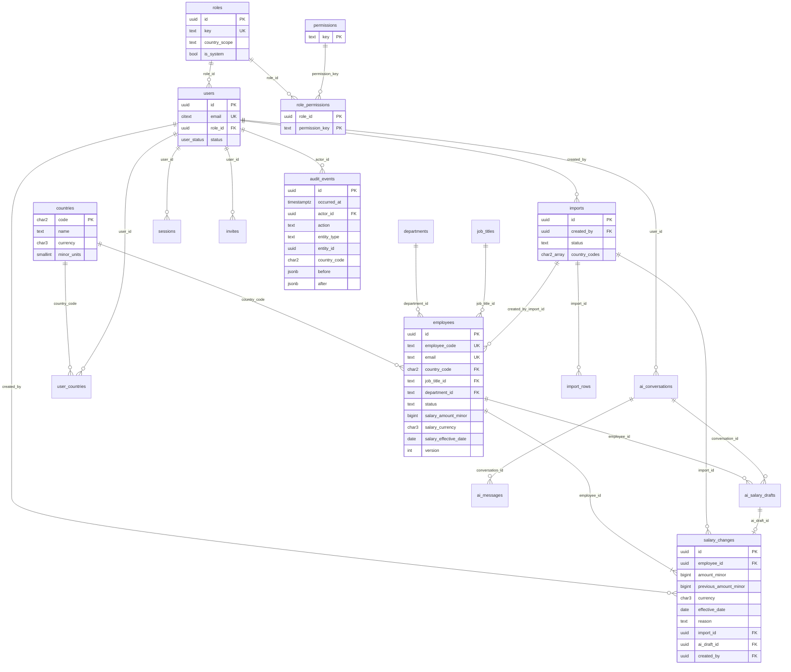

# Database design

Status: **draft for review** · 2026-11-20 · Nothing here is built yet (no migrations exist).

The Postgres schema implied by [requirements.md](requirements.md), [api.md](api.md), [auth.md](auth.md) and the Zod schemas in `packages/shared/src`. Where this document adds something the other docs do not say (import, Ask AI and catalogue tables, most indexes), it is a proposal. Where the docs disagree with each other, the point is listed under [Open questions](#open-questions) rather than decided here.

Conventions:

- Postgres 16+ (Render Postgres). Extensions: `pgcrypto` is not needed (`gen_random_uuid()` is built in), `citext` (users' sign-in email, from auth.md), `pg_trgm` (only if the search index below is kept).
- IDs are `uuid default gen_random_uuid()`. Catalogue IDs are slugs (`data-analyst`). Times are `timestamptz`; calendar dates are `date`.
- Money is `bigint` minor units plus `currency char(3)`. Amounts are positive. The currency always follows the employee's country (enforced by a composite foreign key, below).
- Closed value lists are `text` plus a `CHECK`, not Postgres enums, except `user_status`, which auth.md defines as an enum. Roles are rows in `roles`, not an enum, because Global HR can add them. Reason: `text =` is a leakproof operator, which matters for index use under RLS (see [Indexes and RLS](#how-indexes-interact-with-rls)), and adding a value is a one-line migration either way.
- Scale: 10,000 employees in 8 countries, about 20 HR users, a salary history of a few rows per employee, an audit log that grows without bound but slowly. At this size Postgres scans the whole `employees` table in a few milliseconds, so most indexes below are about keeping the 200 ms target comfortable and plans predictable, not about making the impossible possible. Indexes that are not clearly needed are marked **optional** or **add when measured**.

## Entities

| Table | Rows (approx.) | Under RLS | Purpose |
| --- | --- | --- | --- |
| `countries` | 8 | no | Country, its currency and minor units |
| `departments` | ~7 | no | Fixed catalogue |
| `job_titles` | ~25 | no | Fixed catalogue |
| `fx_rates` | 8 per rate date | no | Fixed, dated USD rates for indicative totals |
| `users` | ~20 | no | HR users (auth.md) |
| `user_countries` | ~30 | no | Countries for users whose role is limited to assigned countries (auth.md) |
| `roles` | a few | no | Roles: name, country scope, system flag (auth.md, RBAC) |
| `permissions` | 11 | no | Permission catalogue, seeded from code (auth.md, RBAC) |
| `role_permissions` | tens | no | Which permissions each role grants (auth.md, RBAC) |
| `sessions` | tens | no | Server-side sessions (auth.md) |
| `invites` | tens | no | Invite and password-reset links (auth.md) |
| `employees` | 10,000 | yes | Current state of each person, including current salary |
| `salary_changes` | ~25,000 | yes | Append-only salary history |
| `audit_events` | grows | yes | Who changed what, when, before and after |
| `imports` | hundreds | proposed | One Excel/CSV import and its status |
| `import_rows` | up to 10,000 per import | proposed | Parsed rows, dry-run outcome and errors |
| `ai_conversations` | grows | proposed | Ask AI conversations, owned by one user |
| `ai_messages` | grows | via conversation | Messages and tool calls in a conversation |
| `ai_salary_drafts` | grows | proposed | Salary changes proposed by Ask AI (`aiDraftId`) |
| `app_private.ai_scope` | 0–2 | no | Scope of the Ask AI connection, keyed by backend PID (auth.md) |

20 tables: 19 in `public`, 1 in `app_private`.



## Tables

### `countries`

| Column | Type | Null | Default | Notes |
| --- | --- | --- | --- | --- |
| `code` | `char(2)` | no | | PK. `CHECK (code ~ '^[A-Z]{2}$')` |
| `name` | `text` | no | | `UNIQUE` |
| `currency` | `char(3)` | no | | ISO 4217. `CHECK (currency ~ '^[A-Z]{3}$')` |
| `minor_units` | `smallint` | no | | `CHECK (minor_units between 0 and 3)`. Served by `/api/meta` as `minorUnits` |

Constraints: `UNIQUE (code, currency)`. This is the target of the composite foreign key from `employees`, which makes "currency follows country" a database rule, not only a service rule.

Seeded by migration; not editable in v1 (api.md, Meta).

### `departments`, `job_titles`

| Column | Type | Null | Notes |
| --- | --- | --- | --- |
| `id` | `text` | no | PK, slug. `CHECK (id ~ '^[a-z0-9]+(-[a-z0-9]+)*$')` (same rule as `catalogueIdSchema`) |
| `name` | `text` | no | `UNIQUE` |

Seeded by migration. No rows are ever deleted or renamed by the app, which is why the foreign keys pointing at them need no supporting index (see [FK indexes](#foreign-key-indexes)).

### `fx_rates`

| Column | Type | Null | Notes |
| --- | --- | --- | --- |
| `as_of` | `date` | no | `ratesAsOf` in the API |
| `currency` | `char(3)` | no | `CHECK (currency ~ '^[A-Z]{3}$')` |
| `usd_per_unit` | `numeric(20,10)` | no | USD per one major unit (`INR: 0.012`). `CHECK (usd_per_unit > 0)` |

PK `(as_of, currency)`. The API uses the latest `as_of`. Not money, so `numeric` rather than minor units; results are rounded half-up to USD cents and labelled indicative. No FK to `countries.currency`, because a currency is not unique per country if two countries share one (EUR).

### `users` (from auth.md)

| Column | Type | Null | Default | Notes |
| --- | --- | --- | --- | --- |
| `id` | `uuid` | no | `gen_random_uuid()` | PK |
| `email` | `citext` | no | | `UNIQUE`. Case-insensitive sign-in |
| `name` | `text` | no | | |
| `role_id` | `uuid` | no | | FK `roles(id) ON DELETE RESTRICT`. One role per user |
| `status` | `user_status` enum (`invited`, `active`, `deactivated`) | no | `'invited'` | |
| `password_hash` | `text` | yes | | argon2id PHC string |
| `failed_sign_ins` | `int` | no | `0` | `CHECK (failed_sign_ins >= 0)` |
| `locked_until` | `timestamptz` | yes | | |
| `last_sign_in_at` | `timestamptz` | yes | | **Added**: `GET /api/users` returns `lastSignInAt` but auth.md's table has no column for it |
| `version` | `int` | no | `1` | **Added**: `PATCH /api/users/:id` takes `version` (api.md) |
| `created_by` | `uuid` | yes | | FK `users(id)`. Null for the bootstrap admin |
| `created_at`, `updated_at` | `timestamptz` | no | `now()` | |
| `deactivated_at` | `timestamptz` | yes | | |

Constraints: `CHECK (status <> 'active' OR password_hash IS NOT NULL)`; `CHECK ((status = 'deactivated') = (deactivated_at IS NOT NULL))`.

### `user_countries` (from auth.md)

| Column | Type | Null | Notes |
| --- | --- | --- | --- |
| `user_id` | `uuid` | no | FK `users(id) ON DELETE CASCADE` |
| `country_code` | `char(2)` | no | FK `countries(code)` |

PK `(user_id, country_code)`. "At least one row when the user's role has `country_scope = 'assigned'`, none when it is `all`" is a service rule (a cross-row rule; a constraint trigger is possible but not proposed).

### `roles` (from auth.md, RBAC)

| Column | Type | Null | Default | Notes |
| --- | --- | --- | --- | --- |
| `id` | `uuid` | no | `gen_random_uuid()` | PK |
| `key` | `text` | no | | `UNIQUE`, `CHECK (key ~ '^[a-z][a-z0-9_]{1,39}$')`. Stable slug used by seeds, tests and audit rows (`global_hr`) |
| `name` | `text` | no | | `UNIQUE`. Shown in the UI ("Global HR") |
| `description` | `text` | yes | | |
| `country_scope` | `text` | no | | `CHECK (country_scope IN ('all','assigned'))`. Cannot change after creation (service rule) |
| `is_system` | `boolean` | no | `false` | Seeded roles, which cannot be deleted |
| `version` | `int` | no | `1` | `PATCH /api/roles/:id` takes `version` |
| `created_by` | `uuid` | yes | | FK `users(id)`. Null for seeded roles |
| `created_at`, `updated_at` | `timestamptz` | no | `now()` | |

### `permissions` (from auth.md, RBAC)

`key text PK` (for example `employees:write`), `description text not null`. Migrations seed it and keep it in step with the catalogue in `@acme/shared`; `acme_app` can only read it. Dependencies between permissions ("`ai:ask` requires `insights:read`") live in the code catalogue, not in a table.

### `role_permissions` (from auth.md, RBAC)

`role_id uuid not null FK roles(id) ON DELETE CASCADE`, `permission_key text not null FK permissions(key)`, PK `(role_id, permission_key)`. The PK serves `loadSession`'s read of a role's permissions.

### `sessions` (from auth.md)

| Column | Type | Null | Default | Notes |
| --- | --- | --- | --- | --- |
| `id` | `bytea` | no | | PK. SHA-256 of the cookie token. `CHECK (octet_length(id) = 32)` |
| `user_id` | `uuid` | no | | FK `users(id) ON DELETE CASCADE` |
| `created_at` | `timestamptz` | no | `now()` | |
| `last_seen_at` | `timestamptz` | no | `now()` | Idle timeout (2 h), written at most every 5 min |
| `expires_at` | `timestamptz` | no | | Absolute timeout, `created_at + 12h`. `CHECK (expires_at > created_at)` |
| `ip` | `text` | yes | | |
| `user_agent` | `text` | yes | | |

### `invites` (from auth.md)

| Column | Type | Null | Default | Notes |
| --- | --- | --- | --- | --- |
| `token_hash` | `bytea` | no | | PK. `CHECK (octet_length(token_hash) = 32)` |
| `user_id` | `uuid` | no | | FK `users(id) ON DELETE CASCADE` |
| `created_by` | `uuid` | no | | FK `users(id)` |
| `created_at` | `timestamptz` | no | `now()` | |
| `expires_at` | `timestamptz` | no | | `created_at + 72h` |
| `used_at` | `timestamptz` | yes | | Single use |

### `employees`

| Column | Type | Null | Default | Notes |
| --- | --- | --- | --- | --- |
| `id` | `uuid` | no | `gen_random_uuid()` | PK |
| `employee_code` | `text` | no | | `UNIQUE`. `CHECK (employee_code ~ '^[A-Z0-9-]{3,20}$')` (`employeeCodeSchema`). Import matching key |
| `first_name` | `text` | no | | `CHECK (char_length(first_name) between 1 and 100)` |
| `last_name` | `text` | no | | Same check |
| `email` | `text` | no | | `UNIQUE`. `CHECK (email = lower(email))`; the service lower-cases. Import fallback matching key. See open question 7 on `citext` |
| `country_code` | `char(2)` | no | | FK `countries(code)`. Not changeable in v1 (PATCH rejects it) |
| `job_title_id` | `text` | no | | FK `job_titles(id)` |
| `department_id` | `text` | no | | FK `departments(id)` |
| `hire_date` | `date` | no | | |
| `status` | `text` | no | `'active'` | `CHECK (status IN ('active','terminated'))` |
| `termination_date` | `date` | yes | | |
| `termination_reason` | `text` | yes | | `CHECK (termination_reason IN ('resignation','dismissal','redundancy','retirement','end_of_contract','other'))` |
| `termination_note` | `text` | yes | | `CHECK (char_length(termination_note) <= 500)` |
| `salary_amount_minor` | `bigint` | no | | Current annual base salary. `CHECK (salary_amount_minor > 0)`. Written only by `SalaryService.change()` |
| `salary_currency` | `char(3)` | no | | FK `(country_code, salary_currency) → countries(code, currency)` |
| `salary_effective_date` | `date` | no | | Effective date of the latest `salary_changes` row |
| `created_by_import_id` | `uuid` | yes | | FK `imports(id)`. Set when an import created the employee; undo deletes only these |
| `version` | `int` | no | `1` | Optimistic concurrency. `CHECK (version >= 1)` |
| `created_at`, `updated_at` | `timestamptz` | no | `now()` | |
| `search_text` | `text` | no | generated | Only if the trigram index is kept: `GENERATED ALWAYS AS (lower(first_name \|\| ' ' \|\| last_name \|\| ' ' \|\| email \|\| ' ' \|\| employee_code)) STORED` |

Constraints:

- `CHECK ((status = 'terminated') = (termination_date IS NOT NULL AND termination_reason IS NOT NULL))`
- `CHECK (status = 'terminated' OR termination_note IS NULL)`
- `CHECK (termination_date IS NULL OR termination_date >= hire_date)`

The `employees.salary_*` columns duplicate the latest history row on purpose (api.md: "current salary is a simple column"), so the directory, sort by salary and insights never need a "latest row per employee" query. They are kept in step by doing both writes in one transaction in `SalaryService.change()`.

### `salary_changes`

| Column | Type | Null | Default | Notes |
| --- | --- | --- | --- | --- |
| `id` | `uuid` | no | `gen_random_uuid()` | PK |
| `employee_id` | `uuid` | no | | FK `employees(id)` (no cascade; only the undo function deletes) |
| `amount_minor` | `bigint` | no | | `CHECK (amount_minor > 0)` |
| `previous_amount_minor` | `bigint` | yes | | Null only for the first entry. `CHECK (previous_amount_minor > 0)` |
| `currency` | `char(3)` | no | | Copied from the employee (see open question 9) |
| `effective_date` | `date` | no | | Not before the previous entry, not after today (service rules, api.md) |
| `reason` | `text` | no | | `CHECK (reason IN ('annual_review','promotion','market_adjustment','correction','other','hire','import','import_undo'))` |
| `note` | `text` | yes | | `CHECK (char_length(note) <= 500)` |
| `import_id` | `uuid` | yes | | FK `imports(id)` |
| `ai_draft_id` | `uuid` | yes | | FK `ai_salary_drafts(id)` |
| `created_at` | `timestamptz` | no | `now()` | |
| `created_by` | `uuid` | no | | FK `users(id)` |

Constraints:

- `CHECK (reason NOT IN ('correction','other') OR note IS NOT NULL)` (same rule as the Zod schema)
- `CHECK (reason NOT IN ('import','import_undo') OR import_id IS NOT NULL)`
- `CHECK (previous_amount_minor IS NOT NULL OR reason IN ('hire','import'))`

Append-only: `acme_app` has `SELECT, INSERT` only (auth.md). The one exception is the `SECURITY DEFINER` undo function, which deletes the history of employees created by that import.

### `audit_events`

| Column | Type | Null | Default | Notes |
| --- | --- | --- | --- | --- |
| `id` | `uuid` | no | `gen_random_uuid()` | PK. Tiebreaker in the `(occurred_at, id)` cursor |
| `occurred_at` | `timestamptz` | no | `clock_timestamp()` | `clock_timestamp()` rather than `now()`, so events in one transaction keep their order |
| `actor_id` | `uuid` | no | | FK `users(id)`. Policy requires it to equal `app.user_id` |
| `actor_role` | `text` | no | | Role `key` at the time of the event (the API returns `actor.role`). Text, not a FK, so the row survives the role being renamed or deleted |
| `action` | `text` | no | | `CHECK (action IN ('employee.created','employee.updated','employee.terminated','salary.changed','import.committed','import.undone','export.created','user.invited','user.updated','user.deactivated','role.created','role.updated','role.deleted'))` |
| `entity_type` | `text` | no | | `CHECK (entity_type IN ('employee','import','export','user','role'))` |
| `entity_id` | `uuid` | yes | | Null for `export.created` |
| `entity_label` | `text` | no | | e.g. `ACM-004211 Asha Rao`, so the log reads well after renames |
| `country_code` | `char(2)` | yes | | FK `countries(code)`. The affected employee's country; null for user, import and export events (open question 2) |
| `before` | `jsonb` | yes | | Changed fields only |
| `after` | `jsonb` | yes | | Changed fields only |
| `import_id` | `uuid` | yes | | FK `imports(id)` (`context.importId`) |
| `ai_draft_id` | `uuid` | yes | | FK `ai_salary_drafts(id)` (`context.aiDraftId`) |
| `details` | `jsonb` | yes | | Extra context, e.g. export filters |

Insert-only for `acme_app`.

### `imports`

| Column | Type | Null | Default | Notes |
| --- | --- | --- | --- | --- |
| `id` | `uuid` | no | `gen_random_uuid()` | PK |
| `created_by` | `uuid` | no | | FK `users(id)` |
| `status` | `text` | no | `'uploaded'` | `CHECK (status IN ('uploaded','validated','committed','undone','failed'))`. Commit and undo are `UPDATE … WHERE status = 'validated'` / `'committed'`, so a repeat returns 0 rows → 409 |
| `file_name` | `text` | no | | |
| `file_format` | `text` | no | | `CHECK (file_format IN ('xlsx','csv'))` |
| `file_size_bytes` | `int` | no | | `CHECK (file_size_bytes BETWEEN 1 AND 5242880)` |
| `file_sha256` | `bytea` | no | | Lets the UI warn "this file was already imported" |
| `columns` | `jsonb` | no | | Detected headers |
| `mapping` | `jsonb` | yes | | Set by `PUT /mapping` |
| `defaults` | `jsonb` | yes | | e.g. `{ country, salaryEffectiveDate }` |
| `summary` | `jsonb` | yes | | `{ rows, create, update, unchanged, error }` |
| `country_codes` | `char(2)[]` | no | `'{}'` | Countries the valid rows touch; used by the proposed RLS policy |
| `failure_message` | `text` | yes | | |
| `created_at` | `timestamptz` | no | `now()` | |
| `validated_at`, `committed_at`, `undone_at` | `timestamptz` | yes | | |

The uploaded file itself is not stored. Upload parses it once into `import_rows.raw`, so remapping and re-running the dry run never need the file again.

### `import_rows`

| Column | Type | Null | Notes |
| --- | --- | --- | --- |
| `import_id` | `uuid` | no | FK `imports(id) ON DELETE CASCADE` |
| `row_number` | `int` | no | Spreadsheet row number, as HR sees it in Excel. `CHECK (row_number >= 1)` |
| `raw` | `jsonb` | no | The row's cells, by column index |
| `outcome` | `text` | yes | Null until the dry run. `CHECK (outcome IN ('create','update','unchanged','error'))` |
| `employee_code` | `text` | yes | Matched or parsed code |
| `employee_id` | `uuid` | yes | FK `employees(id) ON DELETE SET NULL` (undo removes created employees) |
| `country_code` | `char(2)` | yes | |
| `changes` | `jsonb` | yes | `{ field: { from, to } }`; also what undo restores |
| `errors` | `jsonb` | yes | `[{ column, message }]` |

PK `(import_id, row_number)`. `CHECK (outcome <> 'error' OR errors IS NOT NULL)`.

### `ai_conversations`, `ai_messages`, `ai_salary_drafts`

None of the docs define these yet; they follow from api.md ("the server keeps the conversation", `aiDraftId` on salary changes).

`ai_conversations`: `id uuid PK default gen_random_uuid()`, `user_id uuid not null FK users(id)`, `created_at`, `updated_at timestamptz not null default now()`.

`ai_messages`: `conversation_id uuid not null FK ai_conversations(id) ON DELETE CASCADE`, `seq int not null`, `role text not null CHECK (role IN ('user','assistant','tool'))`, `content jsonb not null` (text, tool calls and tool results as the model loop stores them), `input_tokens int`, `output_tokens int` (for the per-conversation token budget), `created_at timestamptz not null default now()`. PK `(conversation_id, seq)`.

`ai_salary_drafts`: `id uuid PK default gen_random_uuid()` (the `draftId`), `conversation_id uuid not null FK ai_conversations(id)`, `employee_id uuid not null FK employees(id) ON DELETE CASCADE` (so import undo can still delete employees it created), `current_amount_minor bigint not null`, `proposed_amount_minor bigint not null CHECK (> 0)`, `currency char(3) not null`, `effective_date date not null`, `reason text not null` (user-pickable reasons only), `note text`, `version_at_draft int not null` (the employee's `version` when drafted), `created_at`, `expires_at timestamptz not null` (7 days later), `applied_at timestamptz`. A draft is stale when the employee's version changed or `expires_at` has passed.

Built in migration `0007_ask_ai` (decisions #36–#42). `ai_messages` also stores `model`. `salary_changes.ai_draft_id` references `ai_salary_drafts(id)`.

### `ai_sql_runs`

The Ask AI SQL audit log: one row per `run_sql` attempt, rejected ones included, written in its own transaction so a failed answer still leaves a record. Append-only (`acme_app` has `SELECT, INSERT` only). Result rows are never stored.

`id uuid PK`, `conversation_id uuid FK ai_conversations(id)`, `user_id uuid FK users(id)`, `message_seq int`, `tool_call_id text`, `sql_text text`, `countries char(2)[]` (the scope it ran with), `status text CHECK (ok, rejected, error, timeout)`, `error_code text`, `error_message text`, `row_count int`, `truncated boolean`, `duration_ms int`, `model text`, `created_at timestamptz default now()`. Indexes on `(created_at, id)` and `(user_id, created_at)` for the keyset-paged `GET /api/ai/sql-runs`.

### `app_private.ai_scope` (from auth.md)

`backend_pid int PK`, `countries char(2)[] not null`, `expires_at timestamptz not null`. No role column: RLS reads only the resolved countries (auth.md, RLS policies).

## Indexes

Primary keys and `UNIQUE` constraints create their own indexes and are listed in the table sections; they are not repeated here except where they serve a named query. Numbering (E1, S1, …) is for review comments.

### Summary

| # | Index | Serves | Verdict |
| --- | --- | --- | --- |
| U1 | `employees (employee_code)` unique | Import matching, search by exact code, sort `employeeCode` | **Required** (constraint) |
| U2 | `employees (email)` unique | Duplicate check on create/PATCH (409), import fallback matching | **Required** (constraint) |
| E1 | `employees (country_code, job_title_id, salary_amount_minor) WHERE status = 'active'` | All insights; RLS country predicate; directory country filter | **Required** |
| E2 | `employees USING gin (search_text gin_trgm_ops)` | Directory `q` | **Add when measured**; likely unused under RLS |
| E3 | `employees (job_title_id, country_code, salary_amount_minor) WHERE status = 'active'` | `/insights/titles/:jobTitleId` | Optional |
| E4 | `employees (country_code, salary_amount_minor, id) WHERE status = 'active'` | `sort=salary` (one country) | Optional |
| E5 | `employees (created_by_import_id) WHERE created_by_import_id IS NOT NULL` | Import undo | Optional |
| S1 | `salary_changes (employee_id, effective_date DESC, created_at DESC)` | History, latest-entry rule, RLS subquery, FK | **Required** |
| S2 | `salary_changes (import_id) WHERE import_id IS NOT NULL` | Import undo | **Recommended** |
| S3 | `salary_changes (ai_draft_id) WHERE ai_draft_id IS NOT NULL` unique | A draft is applied at most once | Built (migration 0007; open question 10 decided) |
| A1 | `audit_events (occurred_at DESC, id DESC)` | Audit feed for Global HR | **Required** |
| A2 | `audit_events (country_code, occurred_at DESC, id DESC)` | Audit feed for Country HR (RLS) | **Recommended** |
| A3 | `audit_events (entity_type, entity_id, occurred_at DESC, id DESC)` | Employee timeline | **Required** |
| A4 | `audit_events (actor_id, occurred_at DESC, id DESC)` | `?actorId=`; Country HR "own imports and exports" | Optional |
| R1 | `import_rows (import_id, outcome, row_number)` | Paged review by outcome | **Required** |
| X1 | `sessions (user_id)` | Delete all of a user's sessions | **Required** (auth.md says "indexed") |
| X2 | `sessions (expires_at)` | Expired-session cleanup | Not needed at this size |
| X3 | `invites (user_id) WHERE used_at IS NULL` | Invalidate a user's open links | **Recommended** |
| M1 | `imports (created_at DESC)` | `GET /api/imports` | Not needed at this size |

Totals: 17 secondary indexes listed (E1–E5, S1–S3, A1–A4, R1, X1–X3, M1). **9 are required or recommended** (E1, S1, S2, A1, A2, A3, R1, X1, X3); the other 8 are optional, add-when-measured or not needed. On top of these come 17 primary keys and 7 unique constraints (`countries.name`, `countries (code, currency)`, `departments.name`, `job_titles.name`, `users.email`, and U1, U2 on `employees`).

### How indexes interact with RLS

This is the part to review hardest, because the policies in auth.md, as written, stop Postgres from using most indexes for Country HR. Three separate effects:

#### 1. An `OR` in the policy is not indexable

auth.md's original policy was `scope_role() = 'global_hr' OR country_code = ANY(scope_countries())`. An `OR` whose first arm does not mention a column cannot become an index condition, so for Country HR the country rule is applied as a filter after reading every row. `employees(country_code)` being indexed (auth.md) does not help this predicate.

**Resolved by RBAC (decision #23).** Roles are now data, so a policy can no longer test a role name. `loadSession` resolves the visible countries (every country for an `all`-scope role) into `app.countries`, and auth.md's policies are now `country_code = ANY(scope_countries())`, with no `OR`. The `visible_countries()` function below is superseded; `scope_countries()` does its job. The reasoning still applies.

Proposed: one function that returns the visible countries, and a policy with no `OR`:

```sql
create function app_private.visible_countries() returns char(2)[]
language sql stable as $$
  select case app_private.scope_role()
    when 'global_hr'  then (select array_agg(code) from public.countries)
    when 'country_hr' then app_private.scope_countries()
  end   -- anything else (missing settings) → null → no rows
$$;

create policy employees_in_scope on employees
  for all to acme_app, acme_ai_reader
  using      (country_code = any ((select app_private.visible_countries())))
  with check (country_code = any ((select app_private.visible_countries())));
```

`country_code = ANY($initplan)` is an ordinary index condition, so E1 (leading `country_code`) serves it. For Global HR the array holds all 8 countries and the planner correctly picks a sequential scan; for Country HR with one country it reads about an eighth of the table. The same function replaces the `OR` in the `audit_events` and `imports` policies. Semantics are unchanged, including "missing settings mean no rows".

#### 2. The array type must match the column type

auth.md's `scope_countries()` returns `text[]`, while `country_code` is `char(2)`. `char(2) = ANY(text[])` resolves to `text = text`, which casts the column, and an index on a `char(2)` column cannot serve `country_code::text`. Either the functions return `char(2)[]` (as above, `string_to_array(...)::char(2)[]`, and `ai_scope.countries char(2)[]`), or every `country_code` column becomes `text` with a `CHECK`. This draft does the former to stay close to auth.md.

#### 3. Non-leakproof conditions cannot use an index under RLS

Postgres evaluates a query's own conditions after the policy's, unless the condition's operator is marked `LEAKPROOF` (otherwise a function could leak values of rows the policy hides). A non-leakproof condition is therefore applied as a filter and cannot drive an index scan. Leakproof: `=`/`<`/`>` on `text`, `char`, `int`, `bigint`, `date`, `timestamptz`, `uuid`, `bool`. **Not** leakproof: `LIKE`, `ILIKE`, the `pg_trgm` operators, `lower()`; `citext` and enum comparison need checking (`select proname, proleakproof from pg_proc where proname in ('citext_eq','enum_eq')`). Only a superuser can mark a function leakproof, and Render's default user is not one.

Consequences for this design:

- `employees.status`, `outcome` and the other value lists are `text` + `CHECK`, so `status = 'active'` stays leakproof and can match E1's partial-index predicate.
- `employees.email` is lower-case `text` rather than `citext`, so import matching by email (`email = ANY($emails)`) can use U2.
- The directory's `q` search (`search_text ILIKE '%rao%'`) **cannot use the trigram index E2** when run as `acme_app`. It runs as a filter over the rows RLS returns: up to 10,000 short strings, a few milliseconds. That is why E2 is "add when measured", and probably never. A code-prefix search can still use U1 by being written as a range (`employee_code >= 'ACM-004' AND employee_code < 'ACM-005'`), which is leakproof.

Verify each of these with `EXPLAIN (ANALYZE, BUFFERS)` while connected as `acme_app` inside a transaction with the `app.*` settings. Never check plans as a superuser: superusers bypass RLS, so their plans show index use that the app will not get. A test that asserts "uses E1 for Country HR insights" is worth having once seed data exists.

### `employees`

**U1, U2: unique `employee_code`, unique `email`.** Required by api.md (`409 conflict` on duplicates) and used by import (`employeeCode`, falling back to `email`). Import should match in one statement per batch (`WHERE employee_code = ANY($1)`), not one query per row.

**E1: insights and country scope.**

```sql
create index employees_active_country_title_salary
  on employees (country_code, job_title_id, salary_amount_minor)
  where status = 'active';
```

- Serves `GET /api/insights/overview` (group by country), `GET /api/insights/by-title?country=` (group by title within one country), `GET /api/insights/distribution?country=&jobTitle=` and Ask AI's `pay_stats`. api.md already promises an "indexed `(country, job_title_id) WHERE status = 'active'`".
- With `salary_amount_minor` in the key, every insights query is answerable from the index alone (index-only scan once autovacuum has marked pages visible): `min`, `max`, `avg`, `sum`, `percentile_disc` and histogram buckets need only these three columns.
- Leading `country_code` serves the RLS predicate (after the rewrite above) and the directory's `country` filter.
- Partial: insights only count active employees (about 95%), and the directory's default `status=active` matches the predicate.

**E2: trigram search.** Optional, see RLS effect 3.

```sql
create extension if not exists pg_trgm;
create index employees_search_trgm on employees using gin (search_text gin_trgm_ops);
```

Serves `q` on `GET /api/employees` and `export.csv` (api.md: "`pg_trgm` index"). Keep only if `EXPLAIN` as `acme_app` shows it used and the measured list endpoint is slow without it; otherwise drop it and the generated column, and update api.md.

**E3: one title across countries.** Optional.

```sql
create index employees_active_title_country_salary
  on employees (job_title_id, country_code, salary_amount_minor)
  where status = 'active';
```

Serves `GET /api/insights/titles/:jobTitleId` ("Data Analysts in India vs the UK"). E1 cannot seek on `job_title_id` because it is second; without E3 that query reads all active rows in scope (about 9,800 for Global HR), which is still a few milliseconds. Add if measured slow.

**E4: sort by salary.** Optional.

```sql
create index employees_active_country_salary
  on employees (country_code, salary_amount_minor, id)
  where status = 'active';
```

Serves `GET /api/employees?country=IN&sort=salary` (api.md requires exactly one country for this sort). It returns the first page without sorting, but the list also needs `count(*)` over all matching rows, so the saving is small. Same reasoning applies to the other sort keys; see "Directory sort" below.

**E5: undo.** Optional.

```sql
create index employees_created_by_import
  on employees (created_by_import_id) where created_by_import_id is not null;
```

Serves `POST /api/imports/:id/undo` ("employees the batch created are removed"). Undo is rare and a scan of 10,000 rows is cheap; the partial index is tiny, so it costs almost nothing either.

**Directory sort and filters: no further indexes.** `GET /api/employees` allows 7 sort keys in 2 directions, with any combination of 4 filters and offset pagination with a total. No small set of indexes covers that, and because `total` needs every matching row counted, Postgres reads all matching rows anyway; a top-25 sort on top of that is cheap at 10,000 rows. `department` and `jobTitle` filters, and sort by name, code, title, department or hire date, therefore rely on E1 (for country) and a top-N sort. Revisit if the employee count grows by 10× (api.md already notes the switch to keyset pagination then).

### `salary_changes`

**S1: history and the latest-entry rule.**

```sql
create index salary_changes_employee_effective
  on salary_changes (employee_id, effective_date desc, created_at desc);
```

- `GET /api/employees/:id/salary-changes` (newest first) reads it in order.
- `SalaryService.change()` checks "not earlier than the latest entry" with `ORDER BY effective_date DESC, created_at DESC LIMIT 1`.
- The `salary_changes` RLS policy (`EXISTS (SELECT 1 FROM employees e WHERE e.id = employee_id)`) joins through `employee_id`; for Ask AI queries over many rows this becomes a semi-join on `employees`' primary key.
- Covers the foreign key to `employees`, which the undo function's deletes need.

**S2: rows written by an import.**

```sql
create index salary_changes_import on salary_changes (import_id) where import_id is not null;
```

Serves `POST /api/imports/:id/undo` (find the batch's salary rows, write `import_undo` compensations) and the "is this import still the latest change" check. Recommended rather than optional because undo runs inside a request and an import touches up to 10,000 employees.

**S3: a draft is used once.** Built in migration 0007: a draft applies once, and a second apply returns `409 draft_applied`.

```sql
create unique index salary_changes_ai_draft on salary_changes (ai_draft_id) where ai_draft_id is not null;
```

### `audit_events`

**A1: global feed.**

```sql
create index audit_events_occurred on audit_events (occurred_at desc, id desc);
```

Serves `GET /api/audit-events` with no filters for Global HR: keyset cursor `WHERE (occurred_at, id) < ($t, $id) ORDER BY occurred_at DESC, id DESC LIMIT 50` (api.md, cursor on `(occurred_at, id)`). Also the `from`/`to` date filters.

**A2: Country HR feed.**

```sql
create index audit_events_country_occurred on audit_events (country_code, occurred_at desc, id desc);
```

Serves the same endpoint for Country HR, where RLS adds `country_code = ANY(visible)`. With one country this is a direct ordered read; with several, Postgres merges or sorts the per-country ranges. Recommended because this table only grows (an import of 10,000 rows writes up to 10,000 events).

**A3: employee timeline.**

```sql
create index audit_events_entity on audit_events (entity_type, entity_id, occurred_at desc, id desc);
```

Serves `GET /api/audit-events?entityType=employee&entityId=…`, which the employee page reads on every open (api.md).

**A4: by actor.** Optional.

```sql
create index audit_events_actor on audit_events (actor_id, occurred_at desc, id desc);
```

Serves `?actorId=` and, if open question 2 adds "own events" to the read policy, the `actor_id = app.user_id` arm. Add with that decision.

### Imports

**R1: review rows by outcome.**

```sql
create index import_rows_outcome on import_rows (import_id, outcome, row_number);
```

Serves `GET /api/imports/:id/rows?outcome=error&page=` and `rows.csv?outcome=error`. The PK `(import_id, row_number)` serves the unfiltered list and commit's in-order pass.

**M1: `imports (created_at desc)`.** Not needed: hundreds of rows at most. `GET /api/imports` sorts in memory.

### Sessions and invites

**PK `sessions(id)`** serves the per-request lookup in `loadSession` (`WHERE id = sha256(token)`, then the PKs of `users`, `roles`, `role_permissions` and `user_countries`; an `all`-scope role reads the 8-row `countries` table instead of `user_countries`). All primary-key lookups, in one query.

**X1: `sessions (user_id)`.** Required: deactivation, password set and invite re-issue delete all of a user's sessions (auth.md).

**X2: `sessions (expires_at)`.** Not needed. Expired rows are deleted on each successful sign-in, and with about 20 users the table holds tens of rows. The cleanup also checks idle time (`last_seen_at`), which an `expires_at` index would not serve anyway.

**X3: `invites (user_id) WHERE used_at IS NULL`.** Recommended: re-issuing a link and deactivation invalidate a user's open links. Small either way.

### Foreign key indexes

Postgres does not index the referencing side of a foreign key. That index matters when the referenced row is deleted or its key updated, or when queries join or filter on the column. Decisions:

| FK | Index | Why |
| --- | --- | --- |
| `salary_changes.employee_id` | S1 | History reads, RLS, undo deletes |
| `salary_changes.import_id` | S2 | Undo |
| `import_rows.import_id` | PK | |
| `ai_messages.conversation_id` | PK | |
| `user_countries.user_id` | PK | |
| `role_permissions.role_id` | PK | |
| `users.role_id`, `role_permissions.permission_key`, `roles.created_by` | none | About 20 users and a handful of roles. Deleting a role checks `users`, which is tiny |
| `sessions.user_id`, `invites.user_id` | X1, X3 | Bulk deletes on deactivation |
| `employees.created_by_import_id` | E5 (optional) | Undo |
| `employees.country_code` | E1 | Leading column |
| `employees.job_title_id`, `.department_id`, `user_countries.country_code`, `audit_events.country_code` | none | Catalogue rows are never deleted or re-keyed |
| `*.created_by`, `audit_events.actor_id`, `imports.created_by`, `ai_conversations.user_id`, `invites.created_by`, `users.created_by` | none (A4 optional) | Users are never deleted (deactivated instead) |
| `salary_changes.ai_draft_id`, `audit_events.import_id`, `audit_events.ai_draft_id`, `import_rows.employee_id`, `ai_salary_drafts.*` | none | Referenced rows are never deleted, except employees removed by undo: the undo function sets `import_rows.employee_id` to null by `import_id` (R1 / PK), not by `employee_id` |

## RLS policies and database roles

From auth.md, with the proposed changes marked.

| Role | Login | Used by | Grants |
| --- | --- | --- | --- |
| `acme_owner` | yes | Migrations, seed | Owns everything; runs `SECURITY DEFINER` functions (import undo) |
| `acme_app` | yes | API server | `SELECT, INSERT, UPDATE` on `employees`, `users`, `imports`, `import_rows`, `ai_conversations`; `SELECT, INSERT` on `salary_changes`, `audit_events`, `ai_messages`, `ai_salary_drafts`; `SELECT, INSERT, UPDATE, DELETE` on `sessions`, `invites`, `app_private.ai_scope`; `SELECT, INSERT, DELETE` on `user_countries`; `SELECT, INSERT, UPDATE, DELETE` on `roles`, `role_permissions`; `SELECT` on `permissions`; `SELECT` on `countries`, `departments`, `job_titles`, `fx_rates`. `NOBYPASSRLS`, no DDL. **The import, AI, catalogue and FX grants are proposed; auth.md does not list them** |
| `acme_ai_reader` | yes | Ask AI `run_sql` | Column-level `SELECT` on `employees` and `salary_changes` without `first_name`, `last_name`, `email`, `termination_note` and `salary_changes.note`; `SELECT` on `countries`, `job_titles`, `departments`, `fx_rates`. Read-only by default, `statement_timeout = 5s`, no `TEMP`, no grant on any `ai_*` table. Built in migration 0007 (auth.md, Ask AI database role) |

| Table | Policy | Status |
| --- | --- | --- |
| `employees` | `country_code = ANY(scope_countries())` for all commands, `WITH CHECK` the same | auth.md (no `OR` since RBAC, effect 1) |
| `salary_changes` | `EXISTS (SELECT 1 FROM employees e WHERE e.id = employee_id)` | auth.md |
| `audit_events` | Read: `country_code = ANY(scope_countries())` (plus own events, open question 2). Insert: `actor_id = app.user_id` | auth.md, rewritten |
| `imports`, `import_rows` | `created_by = app.user_id`, or every country in the import is visible (`country_codes <@ scope_countries()`) | **Proposed**; api.md says imports are RLS-scoped but auth.md has no policy (open question 3) |
| `ai_conversations`, `ai_messages` | `user_id = app.user_id` (messages via their conversation) | Built (0007); api.md says "own only" |
| `ai_salary_drafts` | Employee visible, and conversation owned by `app.user_id` | Built (0007) |
| `ai_sql_runs` | Read: own runs, or all runs for an all-country role. Insert: own `user_id`. No update or delete grant | Built (0007) |
| `employees`, `salary_changes` for `acme_ai_reader` | `FOR SELECT TO acme_ai_reader`, `country_code = ANY(scope_countries())`, where the scope comes from `app_private.ai_scope` by backend PID | Built (0007) |
| Auth tables, catalogues, `fx_rates` | No RLS | auth.md |

All scoped tables use `ENABLE` and `FORCE ROW LEVEL SECURITY`. Policies read scope through `(select app_private.fn())`, which Postgres evaluates once per statement, not once per row.

How the indexes support the policies:

- `employees`: E1 (and E3, E4) lead with `country_code`, which the rewritten policy uses as an index condition. Global HR sees every country, so sequential scans are expected and fine.
- `salary_changes`: no country column. The policy is a semi-join through S1 and `employees`' PK. For per-employee reads (history) that is one PK lookup. For Ask AI aggregates over all history, it is a hash semi-join over the visible employees, which is fine at 25,000 rows. Denormalising `country_code` onto `salary_changes` would make it a direct predicate but duplicates the country rule (open question 8).
- `audit_events`: A2 leads with `country_code` for the same reason as E1.
- `imports`: tiny; no index needed for the policy.

## Implementation notes

- **`bigint` in Node.** `pg` returns `int8` and `numeric` as strings. Register a parser for `int8` (OID 20) that converts to `number` and throws above `Number.MAX_SAFE_INTEGER`, and cast aggregate results (`sum`, `avg` rounded) back to `bigint` in SQL. The largest realistic value is a country's payroll, around 4 × 10¹² paise for India, far below 9 × 10¹⁵.
- **Median.** `percentile_disc(0.5) WITHIN GROUP (ORDER BY salary_amount_minor)`, as api.md says, so the result is a real salary in whole minor units.
- **Undo function.** `SECURITY DEFINER`, owned by `acme_owner`, `SET search_path = public, pg_temp`, takes the import id, checks the caller's scope itself (definer functions bypass RLS), and is the only path that deletes from `employees` and `salary_changes`.
- **`updated_at` and `version`** are set by the services in the same `UPDATE` (`version = version + 1 WHERE id = $1 AND version = $2`), no trigger.

## Open questions

1. **RLS policy rewrite.** Decided with RBAC (decision #23): policies use `country_code = ANY(scope_countries())`, with no `OR`, and auth.md is updated.
2. **Audit visibility.** api.md says Country HR sees "events for employees in assigned countries, plus their own imports and exports"; auth.md's read policy only checks `country_code`, and assumes every audit row has one. `export.created`, `import.*` and `user.*` events have no single country. Options: add `OR actor_id = app.user_id` to the read policy (then A4 becomes useful), or store `country_codes char(2)[]` on the event.
3. **Import scope.** api.md lists imports among RLS-filtered tables; auth.md has no policy for them. This draft proposes "the uploader, or anyone who can see every country in the import". Should a Country HR see imports by other Country HR users for the same country?
4. **Audit writes: service or trigger?** api.md says the service writes the audit row in the same transaction; auth.md recommends triggers on `employees` and `salary_changes`. The hand-off `CLAUDE.md` also mentioned a "DB trigger guard" for append-only history; the current docs rely on grants only. Pick one.
5. **Ask AI reader: tables or views?** Decided (decision #37): base tables with column grants that leave out names, emails and notes; the model works with employee codes and the web app shows the names.
6. **Which 8 countries?** The docs only name IN, GB and US (demo users). The first draft listed US, UK, DE, IN, CA, SG, BR, AU. The `countries` seed migration needs the list, including whether two share a currency.
7. **`employees.email` as lower-case `text` vs `citext`.** `users.email` is `citext` (auth.md). This draft uses lower-case `text` for employees because `citext` comparison may not be leakproof, which would stop U2 being used by import matching under RLS. Check `pg_proc.proleakproof` on the target Postgres and decide.
8. **`country_code` on `salary_changes`?** Denormalising it gives a direct RLS predicate and index, at the cost of a second copy of the country rule. Not proposed at this scale.
9. **Currency consistency on `salary_changes`.** `salary_changes.currency` is copied from the employee by the service. A composite FK `(employee_id, currency) → employees(id, salary_currency)` would enforce it, at the cost of one more unique index on `employees`. Worth it?
10. **Can an AI draft be applied twice?** Decided: no. S3 is built, and stale drafts are refused (decision #39).
11. **`users.last_sign_in_at` and `users.version`** are added here because api.md returns `lastSignInAt` and takes `version`, but auth.md's table has neither. Update auth.md.
12. **`sort=name`** sorts by `last_name, first_name, id` in this draft. Confirm, or sort by first name as displayed.
13. **The trigram index (E2)** should be decided with an `EXPLAIN` as `acme_app`. If it is dropped, api.md's "`pg_trgm` index" line should change.
14. **Dropped fields.** The first draft had `level` (L1–L6) and `employment_type`; the current schemas and docs have neither. Confirm they are intentionally out.
